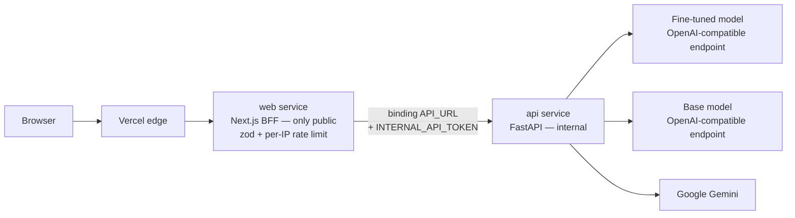

# Job Extractor LoRA

[](https://github.com/drin-tech-tools/job-extractor-lora/actions/workflows/ci.yml)
[](apps/api)
[](apps/web)

> Portfolio project #3 — fine-tune a small open model (~1–3B, QLoRA) to turn raw job postings into clean, validated JSON, and prove it with a held-out test set against its own base model and Gemini.

**Why this task:** it has exact right answers. "Be a better chatbot" can't be measured; "extract `seniority` and `salary_min` correctly" can. The same model is meant to plug into [job-hunt-agent](https://github.com/drin-tech-tools/job-hunt-agent) (project 2) so its postings arrive as structured data.

## Status

| Stage | State |
|---|---|
| Schema, prompts, parsing (single source of truth) | Done, tested |
| Dataset builder + frozen test split | Done, tested — **not yet run on real data** |
| Gemini labeler (distillation, resumable, grounding flags) | Done, tested — **not yet run against the live API** |
| API + Next.js BFF playground | Done, tested; runs end to end in mock mode |
| Test-set review tool (`review_test_set.py`) | Done, tested — **no labels reviewed yet** |
| Eval harness (`evals/eval.py`: metrics, CIs, caching, publish guards) | Done, tested — **never run against a real model** |
| Hand-check ~150 test labels | Not started |
| Baseline (base model + Gemini) | Not started |
| QLoRA fine-tune (Colab T4) | Not started |
| Results table | Not started — [Results page](apps/web/app/results/page.tsx) shows "pending" |
| Publish adapter + model card to the HF Hub | Not started |

No accuracy numbers are claimed anywhere in this repo until `evals/eval.py` produces them.

## The task

Input: raw posting text (≤ 6,000 chars). Output: one JSON object ([`JobExtraction`](apps/api/app/models/schemas.py)):

```json
{"title":"Senior Backend Engineer","seniority":"senior","required_skills":["Python","SQL"],
 "years_experience_min":5,"years_experience_max":null,"work_mode":"remote",
 "salary_min":120000,"salary_max":150000,"salary_currency":"USD","salary_period":"year"}
```

Labeling rules (what counts as "required", how salary shorthand is expanded, ...) live in
[`prompts.py`](apps/api/app/services/prompts.py) and are the same text Gemini is given and the base model is prompted with.

## Architecture

Same shape as job-hunt-agent: one monorepo, one Vercel project (Services), a public Next.js BFF and an internal FastAPI service.



The 1.5B model can't run inside a Vercel function, so the API reaches it over an OpenAI-compatible `/chat/completions` endpoint (an HF Inference Endpoint, a Space running vLLM/llama.cpp, ...). With `EXTRACTOR_MOCK=1` every model key is served by a regex stand-in so the app and CI run with no keys; the UI says so when it's on.

### Repo layout

```
apps/api/        FastAPI: /health, /extract, /extract/compare   (schema + prompts live here)
apps/web/        Next.js UI + BFF routes under /api/*
training/        data/build_dataset.py, label_with_gemini.py, review_test_set.py, notebooks/ (Colab)
evals/           eval.py + metrics.py → results table (apps/web/data/results.json)
vercel.json      Vercel Services: web → api binding
```

## Method

1. **Data** — ~1–2k postings from a Hugging Face dataset and/or the Himalayas + Jobicy boards. The test split (150) is fixed by seeded hash *before labeling* and never moves; postings are de-duplicated by text and by (company, title) so reposts can't leak across the split.
2. **Distillation** — Gemini labels every posting against the schema. Each label gets *grounding flags* (salary digits absent from the text, skills never mentioned, ...) to prioritise hand review.
3. **Hand-check** — `review_test_set.py` steps through the ~150 test drafts (flagged ones first); you accept or fix each. The model never trains on them.
4. **Baseline** — `eval.py --models base gemini`: base model (prompted with the full rules + schema) and Gemini on the test set — valid-JSON rate, per-field accuracy, latency, with confidence intervals.
5. **Fine-tune** — QLoRA on Colab's free T4 using the short `tuned` prompt; the notebook builds examples with the same `build_messages` / `target_json` the API serves with, so there's no train/serve mismatch.
6. **Evaluate + publish** — same test set, three models, paired comparisons that say whether a gap is real or noise; adapter + model card to the HF Hub. See [`evals/README.md`](evals/README.md) for exact metric definitions and what counts against a model.

## Run it locally

```bash
# API (mock mode — no keys needed)
cd apps/api && uv sync --group dev && EXTRACTOR_MOCK=1 uv run uvicorn app.main:app --port 8000

# Web (another terminal)
cd apps/web && npm install && npm run dev      # http://localhost:3000

# Tests
npm run test:api && npm run test:training && npm run test:evals && npm run test:web
```

See [`training/README.md`](training/README.md) for the data pipeline and [`DEPLOYMENT.md`](DEPLOYMENT.md) for Vercel.

## Known limits (by design, before any results)

- Labels are distilled from Gemini, so the fine-tuned model inherits Gemini's judgement calls; only the test set is human-checked.
- ~150 test postings means differences of a few points can be within noise; the Results page shows intervals and only calls a gap real when it excludes zero.
- Test labels are hand-corrected Gemini drafts, so they can lean toward Gemini (anchoring) and Gemini's own score is likely a little optimistic.
- English remote/tech postings from a few sources; other industries, languages and formats are untested.
- Postings over 6,000 characters are truncated; salary is extracted as written (no conversion).
- The public demo has only a best-effort in-memory per-IP rate limit.
